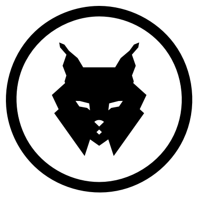

<p align="center"><a href="https://twitter.com/VOSTPTia"></a></p>

<h1><p align="center">VOSTPTia</p></h1>
<h2><p align="center">VOSTPT bot</p></h2>

<p align="center">
    <a href="https://travis-ci.com/vostpt/bot">
        
    </a>
    <a href="https://coveralls.io/github/vostpt/bot?branch=master">
        
    </a>
</p>

# Installation
Use Node.js 20 or 22, then install the dependencies:
```sh
npm ci
```

For local development, `npm install` is also supported.

# Configuration
After installing the dependencies, it's time for a quick configuration.

Create a `.env` file in the project root.

```sh
cp .env.example .env
```

Create the database directory and execute Sequelize migrations for a normal
bot run:

```bash
mkdir ./data
#ENVIRONMENT: development | test | production
npx sequelize-cli db:migrate --env development
```


Add and replace values where needed:

```
#
# Discord bot token
#
# BOT_TOKEN=
BOT_TOKEN=

#
# Cooldown interval in seconds
#
COOLDOWN=

#
# The channels to where messages should be sent
#
MAIN_CHANNEL_ID=
EARTHQUAKES_CHANNEL_ID=
FIRES_CHANNEL_ID=
WARNINGS_CHANNEL_ID=
WARNINGS_AZ_CHANNEL_ID=
WARNINGS_MD_CHANNEL_ID=
TRIGGERS_CHANNEL_ID=
MGMT_CHANNEL_ID=
VOLUNTEERS_CHANNEL_ID=
#TWFEED_CHANNEL_ID=
TWFEED_CHANNEL_ID=
FBFEED_CHANNEL_ID=
DGSCORONA_CHANNEL_ID=
CORONAFAQ_CHANNEL_ID=
JOURNAL_CHANNEL_ID=
TRAVEL_GUIDELINES=


#
# Discord commands user permission list
#

CORONAUPDATEROLES=
CORONAUPDATEUSERS=

RALLYUPDATEROLES=
RALLYUPDATEUSERS=

#
# Twitter configurations
#
# VOST PT Official
TWITTER_CONSUMER_KEY=
TWITTER_CONSUMER_SECRET=
TWITTER_ACCESS_TOKEN_KEY=
TWITTER_ACCESS_TOKEN_SECRET=

# VOST AZ Official
TWITTER_AZ_CONSUMER_KEY=
TWITTER_AZ_CONSUMER_SECRET=
TWITTER_AZ_ACCESS_TOKEN_KEY=
TWITTER_AZ_ACCESS_TOKEN_SECRET=

# VOST Europe Official
TWITTER_EU_CONSUMER_KEY=
TWITTER_EU_CONSUMER_SECRET=
TWITTER_EU_ACCESS_TOKEN_KEY=
TWITTER_EU_ACCESS_TOKEN_SECRET=

# VOSTPTia account
TWITTER_IA_CONSUMER_KEY=
TWITTER_IA_CONSUMER_SECRET=
TWITTER_IA_ACCESS_TOKEN_KEY=
TWITTER_IA_ACCESS_TOKEN_SECRET=

# Portugal DRE Official
TWITTER_DRE_CONSUMER_KEY=
TWITTER_DRE_CONSUMER_SECRET=
TWITTER_DRE_ACCESS_TOKEN_KEY=
TWITTER_DRE_ACCESS_TOKEN_SECRET=

# Rally PT Official
TWITTER_RALLY_CONSUMER_KEY=
TWITTER_RALLY_CONSUMER_SECRET=
TWITTER_RALLY_ACCESS_TOKEN_KEY=
TWITTER_RALLY_ACCESS_TOKEN_SECRET=

# VOST PT Dev
#TWITTER_CONSUMER_KEY=
#TWITTER_CONSUMER_SECRET=
#TWITTER_ACCESS_TOKEN_KEY=
#TWITTER_ACCESS_TOKEN_SECRET=

#
# Facebook configurations
# instructions to get keys: https://gist.github.com/msramalho/4fc4bbc2f7ca58e0f6dc4d6de6215dc0
#

# Main account
FACEBOOK_TOKEN_VOSTPT=
FACEBOOK_TOKEN_RALLY=


#
# FTP configuration
#

FTPSERVER=
FTPUSER=
FTPPASSWORD=

#
# DGS resume spreadsheet
#

DGSRESUMESID=
DGSRESUMESGID=
DGSRESUMESDATAGID=

#
# Firebase key
#

FBASEKEY=


# Node environment (for Sequelize)
# test/development/production

NODE_ENV=

#
# Beta mode (run only beta commands, disable all other functions)
# When disabled ('false' or empty), run all but beta commands
#
BETA_MODE=

#
# Telegram
#
TELEGRAM_API_KEY=
TELEGRAM_CHAT_ID=
TELEGRAM_RALLY_API_KEY=
TELEGRAM_RALLY_CHAT_ID=

#
# Firebase warnings key
#

WARNINGAPPKEY=

#
# Mastodon/Pleroma keys
#

VOSTPT_ACCESS_TOKEN=
PTDRE_ACCESS_TOKEN=

#
# PT Rally csv file location
#
RALLYFILEPATH=

#
# Bluesky keys
#

BSKY_HANDLE=
BSKY_PASS=
BSKY_REPOHANDLE=
```

Some production integrations require `data/auth/vostpt-bot.json`. Shadow mode
does not connect to Discord or publish on social networks; add only the
credentials needed to read the upstream services you want to inspect.

# Running
If you went through the previous steps successfully, you should now be able to run **VOSTPT Discord bot** with the following command:

```sh
npm start
```

For local preview without running the Discord bot or sending posts, use the
[shadow publishing guide](docs/en/shadow-mode.md) or run `npm run shadow`.

This version requires Node.js 20 or 22. The Discord application must have the
Message Content privileged intent enabled when triggers or the remaining prefix
commands are used.

Slash commands are registered to the guild configured by `CLIENT_ID` and
`GUILD_ID`:

```sh
npm run commands:deploy
```

They can be removed from that guild with:

```sh
npm run commands:clear
```

The Corona slash command is intentionally excluded from registration. VOST
Europe's scheduled 08:00/12:00 Twitter posts and Twitter-to-Discord polling
remain disabled, matching `master`.

Scheduled jobs can be controlled with the `JOB_*` variables documented in
`.env.example`. Existing non-Corona production jobs default to enabled; the
already-disabled VOST Europe scheduled posts default to disabled.

### Tests and code checks

Run all automated tests:

```sh
npm test -- --runInBand
```

Run the offline startup and adapter smoke tests with:

```sh
npm run test:smoke
```

Check code style with:

```sh
npm run lint -- src/ config/ scripts/
```

Live smoke tests authenticate against configured social APIs without creating
posts. They are intentionally opt-in:

```sh
LIVE_SMOKE_TESTS=true npm run test:smoke:live
```

Use `LIVE_SMOKE_TARGETS=discord,twitter` to restrict the live checks. Missing
credentials for an explicitly requested target fail the smoke run.

### Compare planned publications with production

Shadow mode fetches current source data and runs the real message-building
code, but replaces outbound Discord and social-network calls with console and
JSON-lines log entries. It uses `data/db.shadow.sqlite`; it does not use the
development or production databases.

Run current IPMA warnings, the daily weather report, and fire events once:

```sh
npm run shadow
```

Choose specific workflows and treat all current records as unseen:

```sh
SHADOW_RESET_DB=true npm run shadow -- warnings weather fire-risk
```

Run the normal production schedule continuously without connecting a Discord
bot or sending social posts:

```sh
npm run shadow:watch
```

Every planned publication is printed as `Would publish to facebook`,
`twitter`, `mastodon`, `telegram`, `bluesky`, or `discord`. The same entries are
written to `logs/publications.jsonl`; set `PUBLISH_LOG_FILE` to choose another
file. Each JSON object includes a timestamp, run ID, destination, account or
channel, exact post text, and media reference. Buffers and very large base64
images are summarized so the log remains usable.

For example, an orange or red IPMA warning produces output similar to:

```text
[DRY-RUN] Would publish to facebook:
{
  "account": "main",
  "message": "ℹ️⚠️🟠 #AvisoLaranja ...",
  "media": "warnings/Twitter_Post_AvisoLaranja_....png"
}
```

This reflects the current rules: yellow IPMA warnings are not sent to Facebook,
and the daily weather report currently has no Facebook publisher. Those absences
are therefore expected in the shadow log and useful when comparing with prod.

Available one-shot workflows are shown with:

```sh
npm run shadow -- --help
```

Shadow mode uses live upstream data, so it only logs content that the bot would
actually consider new. Keep the shadow database to compare behavior over time,
or use `SHADOW_RESET_DB=true` when you want to replay all currently active
warnings. The optional `facebook-feed` workflow needs a Facebook token because
it reads the page feed, but it still does not publish anything.

Tip: use the `BETA_MODE` env variable to toggle which function in [src/jobs/index.json](src/jobs/index.js) is executed  `startProd` (`BETA_MODE=false`) for production and `startBeta`  (`BETA_MODE=true`). 


You should see an output similar to this:
```sh
READY :: Bot started @ 2019-4-14 21:27:00
```

That's it!
